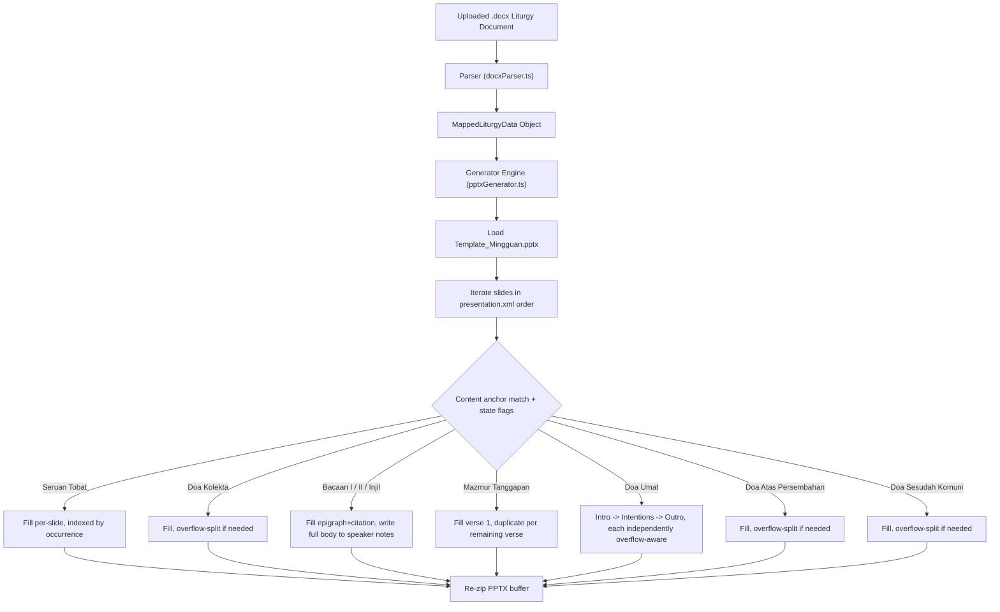

# PPTX Generation & Structural Mapping Specification

Documentation for the PowerPoint generation service in
`app/services/pptxGenerator.ts`. This describes what the code actually
does — verified line-by-line against the implementation, not aspirational
behavior.

---

## 1. Overview & Core Architecture

The PPTX generation engine takes parsed liturgy data (`MappedLiturgyData`
from `app/utils/docxParser.ts`) and fills it into the master template
(`app/template/Template_Mingguan.pptx`), producing a new `.pptx` buffer.

### Core principles

1. **No hardcoded slide indices for section matching.** Slides are
   identified by scanning their own visible text for content anchors
   (e.g. `"MARILAH KITA BERDOA"`, `"BACAAN PERTAMA"`) combined with
   state-machine flags (`hasPassedDoaUmatTitle`,
   `hasPassedDoaKomuniTitle`, `hasPassedBacaanPertama`,
   `hasPassedBacaanKedua`) that track which part of the liturgy the
   loop has already passed.
   - **Known exception**: speaker-notes injection (readings) still
     targets fixed files (`notesSlide2.xml`, `notesSlide3.xml`,
     `notesSlide6.xml`) rather than being resolved dynamically. This
     works because the template is fixed and these numbers were
     confirmed against it, but it means the notes step — unlike slide
     matching — will break silently if the template's internal notes
     numbering ever changes.
2. **OpenXML relationship integrity on duplication.** Duplicating a
   slide updates every place PowerPoint expects a registered slide to
   exist:
   - `[Content_Types].xml` — adds a content-type override for the new
     slide part.
   - `ppt/_rels/presentation.xml.rels` — adds a new numeric `rId` →
     slide file mapping.
   - `ppt/presentation.xml` — inserts a new `<p:sldId>` entry
     immediately after the source slide's entry, so ordering stays
     correct.
   - The duplicated slide's own `.rels` file is copied from the
     source, with any `notesSlide` relationship stripped out (to avoid
     two slides pointing at the same notes part, which corrupts the
     file).
3. **Sentence-boundary overflow chunking.** Text that's too long for
   one slide is split at the last sentence-ending punctuation
   (`. , ! ? ;`) before the character limit, falling back to a word
   boundary, falling back to a hard cut — see §3 below for exact
   behavior and the 35% threshold rule.

---

## 2. Core Helper Functions

| Function                                                        | Purpose                                                                                                                                                                                                                                                                                                                                                             |
| :-------------------------------------------------------------- | :------------------------------------------------------------------------------------------------------------------------------------------------------------------------------------------------------------------------------------------------------------------------------------------------------------------------------------------------------------------ |
| `escapeXml(str)`                                                | Escapes `&`, `<`, `>`, `"`, `'` for safe XML insertion.                                                                                                                                                                                                                                                                                                             |
| `formatEpigraph(epigraph)`                                      | Wraps a reading's epigraph in `"..."` curly quotes if not already quoted.                                                                                                                                                                                                                                                                                           |
| `cleanCitation(citation)`                                       | Strips leading speaker labels (`L.`, `I.`, `Inilah`, `nilah`, etc.) from a reading's source citation line.                                                                                                                                                                                                                                                          |
| `slideHasPlaceholder(slideXml)`                                 | Returns `true` if any paragraph's concatenated text matches `(teks)` (whitespace-tolerant, case-insensitive).                                                                                                                                                                                                                                                       |
| `getPlaceholderCount(slideXml)`                                 | Counts how many paragraphs contain a `(teks)` match.                                                                                                                                                                                                                                                                                                                |
| `replacePlaceholdersInXml(slideXml, replacements[])`            | Walks paragraphs in order; for each one containing `(teks)`, replaces it with the next value from `replacements[]`. Text runs are merged for matching (so a placeholder split across multiple `<a:r>` runs is still found), and the replacement text is written into the first run of that paragraph, with all other runs in the paragraph cleared.                 |
| `replaceDoaUmatIntentionInXml(slideXml, title, body, response)` | Specialized filler for the 2-placeholder Doa Umat intention slide: placeholder 1 becomes two paragraphs (bold title, then unbold body); placeholder 2 becomes the congregational response prefixed with `U\t`.                                                                                                                                                      |
| `stripIntroParagraphs(slideXml)`                                | Inside a `<p:txBody>`, removes every paragraph that comes _before_ the one containing `(teks)` — used so overflow/continuation slides don't repeat a lead-in line like "Marilah kita berdoa".                                                                                                                                                                       |
| `stripClosingParagraphs(slideXml)`                              | Inside a `<p:txBody>`, removes every paragraph that comes _after_ the one containing `(teks)` — used so non-final overflow slides don't prematurely show a closing line like "U. Amin".                                                                                                                                                                             |
| `updateNotesSlideXml(notesXml, notesText)`                      | Replaces the contents of the `type="body"` placeholder shape in a notes slide with the supplied text, split into paragraphs on blank lines.                                                                                                                                                                                                                         |
| `splitTextIntoSlideChunks(text, maxCharsPerSlide)`              | See §3.                                                                                                                                                                                                                                                                                                                                                             |
| `splitLastSentence(bodyText)`                                   | Splits a block of text into everything except its final sentence, and that final sentence alone — used to keep a Doa Umat intention's closing line ("Kami mohon...") together with the congregational response on the same overflow slide.                                                                                                                          |
| `duplicateSlide(sourceFileName, targetRId, newSlideXml)`        | Creates a new slide file with the next available slide number, assigns it a new numeric `rId` and `sldId`, inserts it into `presentation.xml` right after `targetRId`, copies (and cleans) the source's `.rels`, and registers it in `[Content_Types].xml`. Returns the new slide's number, filename, and `rId` so callers can chain further duplications after it. |

---

## 3. Overflow / Chunking Behavior

`splitTextIntoSlideChunks(text, maxCharsPerSlide)`:

- If `text` fits within `maxCharsPerSlide`, returns it as a single
  one-element array — no splitting happens.
- Otherwise, repeatedly takes a slice of `maxCharsPerSlide` characters
  and looks for the **last** occurrence of a sentence-ending
  punctuation mark followed by whitespace: `. , ! ? ;` (all five are
  treated as valid cut points — commas are **included**, not
  excluded).
  - If that cut point falls after 35% of `maxCharsPerSlide`, the chunk
    is cut there (keeping the punctuation).
  - Otherwise, falls back to the last space (word boundary) if it's
    past the same 35% mark.
  - Otherwise, falls back to a hard cut at exactly `maxCharsPerSlide`.
- Repeats on the remainder until what's left fits in one chunk.

`splitLastSentence(bodyText)` uses the same 35%-of-length threshold
idea, but searches for the _last_ sentence delimiter (`. `, `! `, `? `,
`; `, `… `, or a newline) to peel off only the final sentence, not to
chunk the whole text.

Per-section character limits currently in use (passed as
`maxCharsPerSlide`):

| Section                                               | Limit |
| :---------------------------------------------------- | :---- |
| Doa Kolekta                                           | 260   |
| Doa Umat — intro                                      | 260   |
| Doa Umat — intention body                             | 260   |
| Doa Umat — intention body+response combined threshold | 250   |
| Doa Umat — outro/closing                              | 260   |
| Doa Atas Persembahan                                  | 240   |
| Doa Sesudah Komuni                                    | 280   |

These limits are approximations tuned by feel, not measured against
actual template text-box dimensions/font metrics — if a slide is still
visibly overflowing or under-filled after generation, adjusting the
relevant limit is the first thing to try.

---

## 4. Section Mapping & Execution Rules



Every slide with at least one `(teks)` placeholder is checked against
the rules below, in this order, on every iteration — the **first**
matching rule handles the slide.

### Skip rules (checked first)

Any placeholder slide whose text contains `"PENGUMUMAN"` or
`"LIRIK LAGU"` is skipped entirely, untouched.

#### 1. Seruan Tobat
- **Anchor**: Slide text containing `"KASIHANILAH KAMI"`.
- **Parser Logic (`parseSeruanTobatLines` & `stripTobatInvocationEnding`)**:
  - Scans all lines in the Tobat section and groups priest prayers (`I. ...`), capping at **at most 3 items** (`slice(0, 3)`), stopping before the Absolusi prayer (`Semoga Allah...`).
  - Strips trailing invocation ending phrases (`Tuhan, kasihanilah kami` / `Kristus, kasihanilah kami`) as they are already present on the template slides.
  - Filters out congregation response lines (`U. ...`) so that **only Priest ("I") invocation text** is captured into `mappedData.seruanTobat[0..2]`.
- **Fill Logic**: Fills each captured priest prayer item sequentially into corresponding slides.
  placeholder; `seruanCount` increments each time this rule fires, so
  each matching slide gets the next item in order. If there are more
  matching slides than array items, later slides get an empty string.

### 2. Doa Kolekta

- **Anchor**: slide text contains `"MARILAH KITA BERDOA"` and
  `hasPassedBacaanPertama` is still `false`.
- **Limit**: 260 chars.
- **Overflow**: if the text fits in one chunk, fills the original
  slide directly. If it needs multiple chunks: the original slide gets
  its closing paragraph(s) stripped (`stripClosingParagraphs`) and the
  first chunk; each subsequent duplicated slide gets its intro
  paragraph(s) stripped (`stripIntroParagraphs`) and its chunk, with
  the closing line preserved only on the last duplicated slide.

### 3. Bacaan Pertama

- **Anchor**: slide text contains `"BACAAN PERTAMA"` or `"BACAAN I "`.
- **Fill**: placeholder 1 = `formatEpigraph(epigraph)`, placeholder 2 =
  `cleanCitation(citation)`.
- **Speaker notes**: full `notesBody` written into
  `ppt/notesSlides/notesSlide2.xml` (fixed file — see §1 known
  exception).

### 4. Mazmur Tanggapan

- **Anchor**: slide text contains `"MAZMUR"` or `"TANGGAPAN"`, OR
  (`hasPassedBacaanPertama` is true AND `hasPassedBacaanKedua` is
  false) — this fallback branch matches **any** remaining placeholder
  slide in that range, not just ones that look like a psalm. This is
  intentionally broad to catch verse-continuation slides that may not
  repeat the "Mazmur" keyword, but means any other placeholder slide
  template authors add between Bacaan Pertama and Bacaan Kedua would
  also be caught by this rule — keep that in mind if the template
  changes.
- Only fires once (`!hasHandledMazmur` guard) — verse 1 fills the
  matched slide directly, then one duplicate is created per remaining
  verse in `mappedData.mazmurTanggapan.verses`.

### 5. Bacaan Kedua

- **Anchor**: slide text contains `"BACAAN KEDUA"` or `"BACAAN II "`.
- Same fill pattern as Bacaan Pertama. Speaker notes go to
  `ppt/notesSlides/notesSlide3.xml`.

### 6. Bacaan Injil — citation intro

- **Anchor**: slide text contains `"INILAH INJIL SUCI MENURUT"`.
- **Fill**: single placeholder = `mappedData.bacaanInjil.gospelName`
  (e.g. `"Matius 14:22-33"`).

### 7. Bacaan Injil — content

- **Anchor**: slide text contains `"INJIL"` but not `"PENGANTAR"` (so
  it doesn't collide with "Bait Pengantar Injil").
- Same fill pattern as the other readings. Speaker notes go to
  `ppt/notesSlides/notesSlide6.xml`.

### 8–10. Doa Umat (intro, intentions, outro)

State becomes active once a slide's text contains `"DOA UMAT"` and
does _not_ contain `"AMIN"` (this distinguishes the title slide from
the closing slide, which also mentions the section but ends in
"Amin"). Once active, the next three placeholder-bearing slides are
consumed in order by sub-rules 8, 9, 10 below; the state resets after
rule 10 fires so a later, unrelated Doa Umat-like slide (if any)
wouldn't incorrectly re-trigger this flow.

**8. Intro** — first slide reached with exactly 1 placeholder while
`hasPassedDoaUmatTitle` is true and the intro hasn't been handled yet.
Fills `mappedData.doaUmat.intro`, 260-char limit, overflow-aware
(duplicates with no strip logic — the intro slide layout has no
intro/closing formula paragraphs to strip).

**9. Intentions** — next slide reached with 2+ placeholders. For each
item in `mappedData.doaUmat.intentions`:

- Its body is chunked at 260 chars.
- Each non-final chunk fills a slide with title (first chunk only) +
  body, no response text.
- The final chunk is checked against `response.length + chunk.length
  > 250`: if it fits, title/body/response go on one slide. If not,
`splitLastSentence` peels the intention's last sentence (typically
  > "Kami mohon...") off the body, puts the bulk of the body on one
  > slide (no response yet), and puts the peeled last sentence together
  > with the response on the following duplicated slide — so the
  > "prompt" line and the congregation's reply always appear together.
- If there are zero intentions, both placeholders on the matched slide
  are cleared to empty strings (slide stays in the deck, blank).

**10. Outro** — next slide reached after intentions are handled. Fills
`mappedData.doaUmat.closing`, 260-char limit, overflow-aware, no strip
logic (same reasoning as intro).

### 11. Doa Atas Persembahan

- **Anchor**: slide text contains `"DOA ATAS PERSEMBAHAN"` or `"ATAS PERSEMBAHAN"`.
- **Limit**: 240 chars. Same strip-on-overflow pattern as Doa Kolekta
  (intro stripped on continuation slides, closing stripped on all but
  the last).

### 12. Doa Sesudah Komuni

- **Anchor**: activated by `hasPassedDoaKomuniTitle` (set when a slide
  contains `"DOA SESUDAH KOMUNI"` or `"SESUDAH KOMUNI"`) combined with
  not yet handled, OR the anchor text appearing directly on the
  placeholder slide itself.
- **Limit**: 280 chars.
- **Overflow**: continuation slides get `stripIntroParagraphs` applied
  only — **closing paragraphs are not stripped for this section**,
  unlike Doa Kolekta and Doa Atas Persembahan. Confirm this is
  intentional (e.g. the Komuni slide template has no separate closing
  formula paragraph to worry about) rather than a gap, if you're
  auditing this section.

---

## 5. Known Limitations / Things to Watch

- **Notes-slide targets are hardcoded filenames**, not resolved by
  content — if the template's internal notes-part numbering ever
  shifts (e.g. from editing the template in PowerPoint and it
  renumbers notes parts), `notesSlide2/3/6.xml` may no longer
  correspond to Bacaan Pertama/Kedua/Injil. Re-verify these three
  numbers against the template directly after any template edit.
- **The Mazmur fallback anchor is broad** (see §4.4) — it will absorb
  any unexpected placeholder slide between Bacaan Pertama and Bacaan
  Kedua, not only genuine psalm-verse slides.
- **Character limits are untuned estimates**, not derived from the
  template's actual text box dimensions or font metrics. Treat visible
  overflow/underflow in generated slides as a signal to adjust the
  relevant limit in code, not as a parsing bug.
- **`updateNotesSlideXml` matches on `type="body"` appearing before
  `<p:txBody>` in the shape's XML** — if a template edit changes the
  attribute order on that placeholder tag, notes injection could
  silently fail (no error, notes just won't update). Worth a quick
  grep-check against the actual notes XML after any template change.

---

## 6. Verification

After any change to `pptxGenerator.ts`:

```bash
npm run build
```

This catches type errors but **not** structural/OpenXML correctness —
after a build passes, actually open the generated `.pptx` in
PowerPoint (not just a preview tool) to confirm it opens without a
repair prompt and that duplicated slides/notes look correct, since
relationship-integrity bugs (bad `rId`, missing `.rels` entry, etc.)
are silent at the type-checker level.
